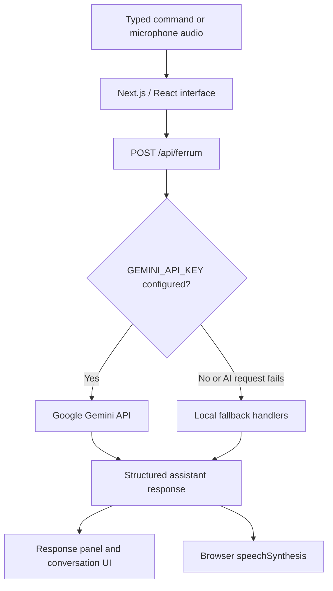

 Ferrum

**Ferrum is an experimental browser-based AI voice assistant with an interactive system-architecture workbench.** It supports typed commands, microphone input, AI-assisted responses through Google's Gemini API, browser-based speech output, and a local fallback handler for selected tasks.

> **Current implementation note:** The app is a Next.js/TypeScript web application. Names such as `ferrum.py`, `diction.py`, `news.py`, and `Face recognition.py` appear in the architecture model and simulated execution traces; corresponding Python runtime modules are not included in this repository. Treat the workbench as an interactive architecture model, not proof that every depicted subsystem is implemented or connected.

## Features

- **Voice and text input:** Send typed prompts or record audio through the browser microphone. Microphone access requires permission and a secure browser context, such as `localhost` during development or HTTPS in production.
- **Gemini-powered responses:** When `GEMINI_API_KEY` is configured, the server route sends text or recorded audio to Gemini and requests a structured response containing the answer, transcript, routing metadata, and UI payload.
- **Browser speech output:** Responses can be read aloud with the browser's Web Speech `speechSynthesis` API. Voice availability depends on the browser and operating system; this is not the Python `pyttsx3` engine.
- **Local fallback:** Without a Gemini key, the API route uses built-in handlers for selected text commands, including basic arithmetic, date/time queries, note management, and Wikipedia summaries when reachable.
- **Saved notes:** Notes are kept in the current browser's `localStorage`. They are not synced to an account or server and will not automatically follow you to another browser or device.
- **Architecture workbench:** The codebase includes a five-layer architecture model, component and dependency inspection, original/corrected topology views, repair-mode interactions, anomaly-audit findings, and step-by-step command-trace playback.
- **Response diagnostics:** API responses can include routing and processing diagnostics useful for development and debugging.

## How it works



The architecture workbench is a separate, data-driven simulation built from the definitions in `lib/ferrum-architecture.ts`. Its topology repair actions update the displayed model; they do not modify or repair a separate Python application.

## Technology stack

- [Next.js](https://nextjs.org/) App Router
- React and TypeScript
- Tailwind CSS
- [Google Gen AI SDK](https://ai.google.dev/gemini-api/docs)
- Browser MediaRecorder, optional Web Speech recognition, and Web Speech synthesis APIs
- Lucide icons and Motion

## Getting started

### Prerequisites

- Node.js (Node 20 or a compatible supported LTS release is recommended)
- npm
- A Google Gemini API key for AI-backed text and audio processing
- A modern browser with microphone access for voice input

### 1. Clone the repository

```bash
git clone https://github.com/BibinBinoy777/Ferrum.git
cd Ferrum
```

### 2. Install dependencies

```bash
npm install
```

### 3. Configure the environment

Create a local environment file from the example:

**macOS / Linux**

```bash
cp .env.example .env.local
```

**Windows PowerShell**

```powershell
Copy-Item .env.example .env.local
```

Open `.env.local` and set your Gemini API key:

```dotenv
GEMINI_API_KEY=your_gemini_api_key_here
```

Keep the key private. Do not commit `.env.local` or place the key in client-side code. The repository's `.gitignore` excludes `.env*` files while allowing `.env.example` to be tracked.

`APP_URL` is present in `.env.example` for hosted-environment configuration, but the current `/api/ferrum` handler uses `GEMINI_API_KEY` for Gemini access.

### 4. Start the development server

```bash
npm run dev
```

Open [http://localhost:3000](http://localhost:3000).

If the browser asks for microphone permission, allow it to use voice input. You can also type a command into the input field.

### Running without a Gemini API key

The app can use its local fallback path for selected **text** commands without a Gemini key. AI-backed general responses and reliable transcription of audio-only recordings require a configured Gemini API key. Some local fallback examples are intentionally static; see **Known limitations** below.

## Available scripts

| Command | Purpose |
| --- | --- |
| `npm run dev` | Start the local Next.js development server. |
| `npm run lint` | Run ESLint. |
| `npm run build` | Create a production build. |
| `npm run start` | Start the production server after a successful build. |

A dedicated automated test script is not currently defined in `package.json`.

## Project structure

```text
Ferrum/
├── app/
│   ├── api/
│   │   └── ferrum/
│   │       └── route.ts                 # Server endpoint for text/audio commands
│   ├── components/
│   │   ├── FerrumVoiceAssistant.tsx     # Main voice assistant interface
│   │   └── FerrumWorkbench.tsx          # Architecture explorer and simulator
│   ├── globals.css
│   ├── layout.tsx
│   └── page.tsx
├── components/
│   └── FerrumArchitectureCanvas.tsx     # Architecture graph canvas
├── hooks/                               # Shared React hooks
├── lib/
│   └── ferrum-architecture.ts           # Layers, nodes, edges, traces, and audit data
├── public/                              # Static assets
├── .env.example
├── package.json
└── next.config.ts
```

## Current architecture model

The workbench groups the conceptual assistant into five layers:

1. **User I/O** — microphone and speaker endpoints.
2. **Core engine** — the conceptual orchestrator, speech pipeline, and command dispatcher.
3. **Module layer** — modeled task handlers such as notes, news, media, OCR, and biometrics.
4. **External services** — modeled external APIs and services.
5. **Data and models** — modeled files and recognition-model artifacts.

The nodes, edges, anomaly classifications, and example command traces are defined as frontend data. Changing the displayed topology is an educational/debugging interaction in the workbench rather than a live infrastructure change.

## Known limitations

- **Not a standalone Python assistant:** The repository currently contains the web interface and a Next.js API route, not a local Python daemon or desktop runtime.
- **Some integrations are demonstrations:** In the no-key fallback, weather and news replies are hard-coded examples. Face-recognition and YouTube responses also describe simulated routing rather than performing a real biometric scan or starting YouTube playback. These should not be treated as live telemetry or verified actions.
- **Architecture repairs are simulated:** Repair controls update the visual graph and audit state only.
- **Notes are browser-local:** Saved notes use `localStorage`; there is no user account, cloud synchronization, or server-side note database.
- **Conversation context is limited:** The interface shows previous turns, but the current request flow does not provide a durable server-side conversation store.
- **Workbench access:** The homepage opens the voice-assistant view by default, and the architecture launcher is currently hidden in the interface source. The workbench code is present, but an explicit visible navigation control or route would improve access.
- **No test script or repository license file:** `package.json` does not define a test command, and a `LICENSE` file is not currently present at the repository root. Add automated tests and choose an appropriate license before presenting the project as production-ready or inviting reuse.

## Privacy and security

- Keep `GEMINI_API_KEY` on the server in `.env.local`; never expose it in browser code or commit it to Git.
- When Gemini is configured, recorded audio and/or the text command are sent to the Ferrum API route and processed by Google's Gemini service. Do not submit sensitive audio or personal information unless you are comfortable with that processing.
- Microphone recording requires explicit browser permission. Use HTTPS for a deployed site.
- Notes are stored in browser `localStorage` on the device/profile in use. Anyone with access to that browser profile may be able to access them.

## Development notes

- The API entry point is `app/api/ferrum/route.ts`.
- The voice interface is in `app/components/FerrumVoiceAssistant.tsx`.
- The workbench's architecture data is in `lib/ferrum-architecture.ts`.
- The architecture graph is rendered by `components/FerrumArchitectureCanvas.tsx`.

Issues and contributions are welcome. When reporting a problem, include the browser, Node.js and npm versions, the command or interaction that triggered it, and any relevant server-console diagnostics. Never include API keys or other secrets in an issue report.
